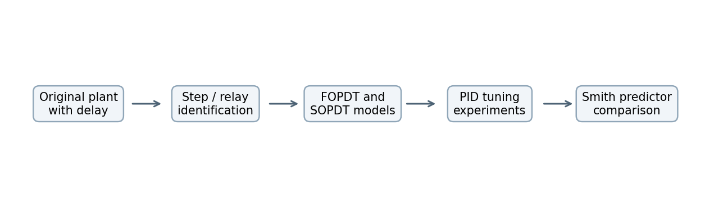
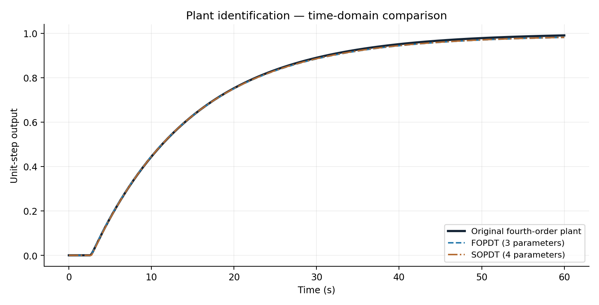
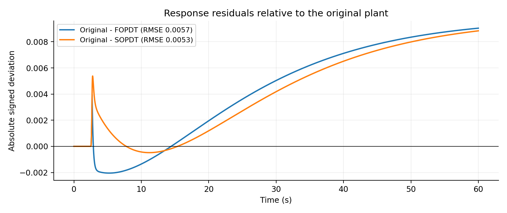
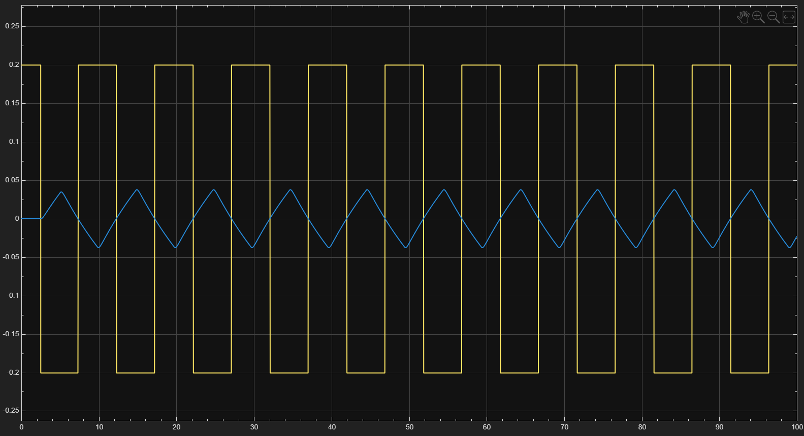
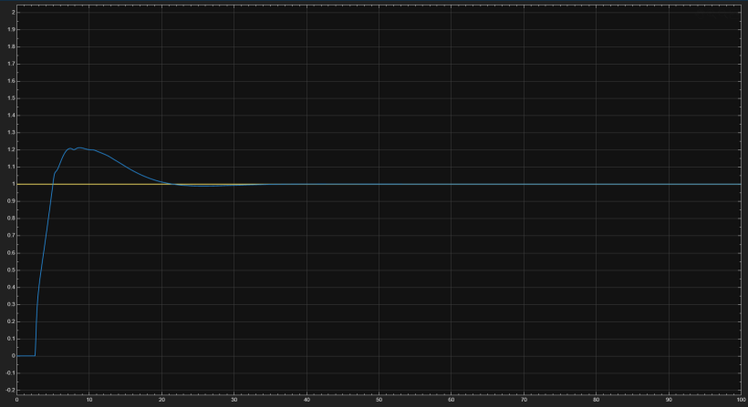
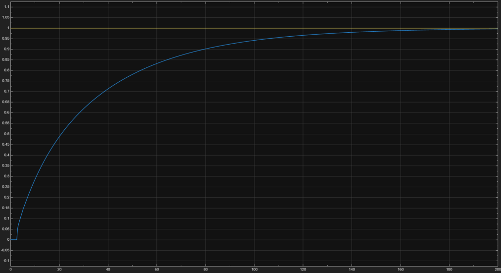
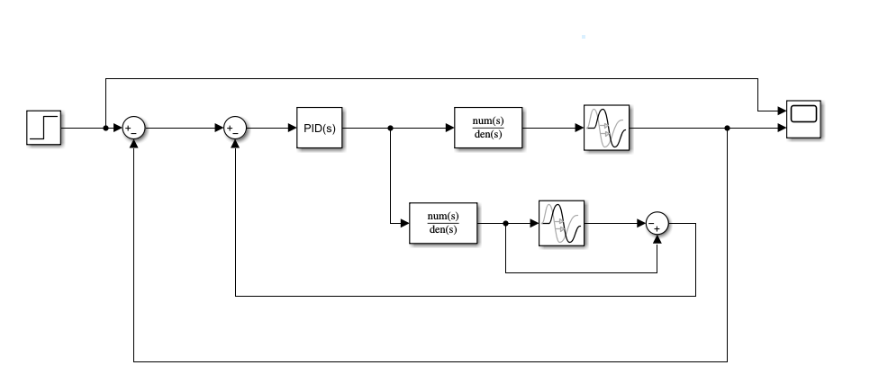
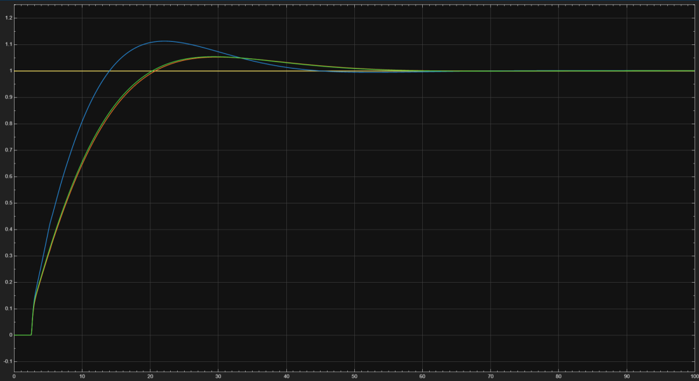

# Industrial Process Control: PID Tuning & Smith Predictor

**Fourth-order time-delay process | Model identification | Relay feedback | PID tuning | Dead-time compensation**

A comprehensive industrial control engineering study that combines process approximation, closed-loop controller experiments, and Smith predictor analysis. The repository documents the original MATLAB/Simulink work and supplements it with clean reproducible identification scripts, explicit technical limitations and independent numerical plots.

> **Evidence status:** Original time- and frequency-domain PID experiments and Smith predictor configurations are contained in the supplied Simulink project and coursework report. Independent verification here covers the process model, reduced-order response comparisons and numerical consistency checks; it does not claim a fresh end-to-end execution of all Simulink control scenarios.



## 1. Original plant

```math
G(s)=\frac{1000e^{-2.5s}}{s^4+126s^3+2725s^2+12600s+1000}
```

The task is to approximate the delayed fourth-order process using three- and four-parameter identified models, then compare several PID tuning strategies and Smith-predictor arrangements. The true DC gain is **1.0**.

## 2. Identified process models

| Model | Form | Recorded parameters |
|---|---|---|
| FOPDT | `K exp(-Ls)/(Ts+1)` | K=0.990211, L=2.698647 s, T=12.201353 s |
| SOPDT | `K exp(-Ls)/((T1s+1)(T2s+1))` | K=0.990211, L=2.698647 s, T1=12.128868 s, T2=0.063750 s |

### Model comparison



### Residuals and numerical fit



On a 0-60 s sampled unit-step experiment (0.02 s interval), the independently recomputed RMSE is **0.005663** for the FOPDT approximation and **0.005250** for SOPDT. These numbers quantify the specific archived parameter estimates, not a globally optimized identification fit.

## 3. Controller experiments

The original project investigates:

1. Relay-feedback oscillation-point estimation.
2. Ziegler-Nichols PID tuning from a time-domain procedure.
3. Ziegler-Nichols PID tuning in the frequency domain.
4. Generalized Ziegler-Nichols tuning at a specified target point.
5. Lambda-based PID tuning and subsequent tuning experiments.
6. Smith predictor experiments under different internal-model assumptions.

Comparisons in the original report include cases of oscillation and tuning sensitivity. They are treated as engineering findings rather than hidden or characterized as universally stable.

### Experimental evidence from the original report

The following images were taken from the submitted simulation report and document the experiment configurations and observed traces. They are **source results**, not newly validated MATLAB runs.

| Experiment | Evidence |
|---|---|
| Relay-feedback characterization |  |
| PID retuning |  |
| Lambda-based tuning |  |
| Smith predictor structure |  |
| Smith predictor comparison |  |

## 4. Source files

```text
industrial-control-pid-smith-predictor/
├── README.md
├── requirements.txt
├── .gitignore
├── matlab/run_identification.m
├── simulink/industrial_control_experiments.slx
├── archive/original-analysis/
│   ├── step_response_identification.m
│   ├── step_response_thresholds.m
│   ├── four_parameter_fit.m
│   └── model_comparison_rmse.m
├── tests/test_model.py
└── docs/
    ├── TECHNICAL_REPORT.pdf
    ├── MODEL_AND_METHODS.md
    ├── VALIDATION.md
    └── images/
```

The archived scripts are retained in English-only presentation form with their original computational logic. They are not a claim that all archived code has been executed in the current environment. The original Persian coursework report and assignment sheet are not redistributed.

## 5. Reproduce the results

Requires **MATLAB + Simulink + Control System Toolbox**; specific toolboxes may be needed for selected blocks in the original model.

```matlab
run('matlab/run_identification.m')
```

For independent Python consistency checks:

```bash
python -m pip install -r requirements.txt
python -m unittest discover -s tests -v
```

## 6. Academic documentation

- [Technical engineering report (PDF)](docs/TECHNICAL_REPORT.pdf)
- [Mathematical model and methodology](docs/MODEL_AND_METHODS.md)
- [Verification notes and outstanding checks](docs/VALIDATION.md)

## 7. Further development

Standardize simulated disturbance and reference inputs, evaluate rise/settling time, overshoot, integral error and control effort for every controller, quantify sensitivity to model mismatch, and independently reproduce the full Smith-predictor Simulink paths. Those are proposed next steps, not claimed completed tests.

## Usage

No open-source license has been selected. Check permission before reusing or redistributing third-party material.
